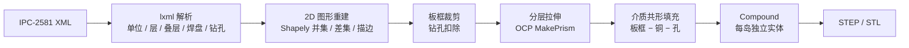

# ECAD2STEP

> **下载 Windows 版**：[Releases v1.0](https://github.com/Aihebinkele/ECAD2STEP/releases/tag/v1.0)
> 文件夹版解压即用（推荐）；单文件版适合单独拷贝。

> [!abstract] 一句话
> 读取 ECAD 导出的 IPC-2581 XML，把每层铜箔、介质和钻孔还原成精确的 3D 实体，导出 STEP 供 Abaqus 等 CAE 软件直接导入。

---

## 为什么做这个工具

这个工具来自一次具体的 PCB 仿真需求：手头只有 ECAD 导出的 `.emp`、`.emn`、`.xml` 文件，需要把 PCB 的铜箔、介质和钻孔变成可网格化的 3D 几何，导入 Abaqus 做热分析和热-结构分析。

原来的做法是在 ANSA 中走 ECAD Importer 流程（原始工程目录名就是 `use ECAD to create PCB model in ANSA`）。这条链路能用，但把建模步骤绑在商业前处理环境里，参数不透明，也不方便批量、重复地生成同一块板的模型。

于是把其中最核心的一段独立出来：

- **输入**：IPC-2581 XML，而不是 IDF。IDF 只有板框、孔和器件位置，==没有铜箔图形==，做不出“精确铜层”。
- **处理**：2D 布尔运算 + 沿 Z 向拉伸，思路对齐 ANSA ECAD Importer Level 5 的“全 3D 金属化”模型。
- **输出**：STEP B-rep 实体，而不是 STL 三角面片。CAE 前处理需要实体和解析曲面，STL 只适合预览或 3D 打印。

最终做成一个双击即用的小工具：不依赖 ANSA / Abaqus 许可，选一个 XML、选一个输出路径，就能得到可复现的铜层模型。

> [!tip] 为什么默认 STEP
> Abaqus 导入 STEP 后得到的是实体 Part 和 cell，可以分别赋铜 / FR4 材料、画六面体或四面体网格；STL 只有三角面片，无法表达材料分区，也不利于网格控制。`.step` 与 `.stp` 是同一个 ISO-10303-21 格式，只是扩展名不同，Abaqus 都能识别。

---

## 实际用途

| 场景 | 用到的模型特征 | 关注点 |
|------|----------------|--------|
| PCB 热仿真 | 铜层、介质层、钻孔 | 铜作为导热路径，平面层和热过孔决定结温 |
| 热-结构 / 翘曲 | 完整叠层 + 真实铜分布 | CTE 失配、层间应力、焊点可靠性 |
| 焦耳热 / 电流密度 | 铜走线截面、过孔 | 需要真实铜几何，不能用等效块代替 |
| 共轭传热 / CFD | 铜表面、板面 | 铜箔表面作为流固耦合壁面 |
| 模型轻量化 | 只铜层、按层拆分、简化容差 | 减少 cell 数量和网格规模 |
| 几何归档 / 可视化 | STEP / STL | 不打开 ECAD 软件也能查看 PCB 结构 |

> [!example] 实测样例
> TV PCB `VD24053`：99.060 × 110.490 mm，6 层铜 + 5 层介质，总厚 1.168 mm，174 个钻孔，生成 917 个独立 cell。Abaqus 2017 导入约需 10 分钟，因此工具支持按层拆分导出。

---

## 生成原理



### 1. 解析与单位统一

用 `lxml` 解析 IPC-2581，读取 `CadHeader` 的单位，把 inch / mil / micron 统一换算成 mm。层定义、叠层顺序、板框、焊盘栈、钻孔和每层铜图形分别收集。

### 2. 2D 图形重建

把 XML 中的图元还原成 Shapely 多边形：

- `Circle`、`Rect`、`Obround`、`Polygon`、`Arc`、`Line`、`Polyline` 等标准图元；
- 线宽和圆弧按 ==描边== 处理，而不是零宽度线；
- 焊盘栈、旋转、镜像、负图形（clearance）逐项合成；
- 同一层内所有铜图形做并集，再裁剪到板框以内。

这一步决定了铜层的形状精度，也是整个流程里最耗 CPU 的部分。

### 3. 钻孔扣除

钻孔不按多边形近似，而是在 2D 铜面上做差集：

- 焊盘从实心圆变成圆环；
- 平面层得到真实开孔；
- 介质面用 `gp_Circ` 精确圆孔建面，避免几十个侧立面导致 STEP 膨胀。

> [!note] 钻孔默认按通孔处理
> 当前版本把每个钻孔贯穿整个板厚，尚未按 IPC-2581 的层跨度区分盲孔 / 埋孔。电镀孔默认是空孔，勾选“电镀孔做成实心铜柱”后才会生成贯穿铜柱。

### 4. 分层拉伸

按叠层把 Z 向切成若干 band：

- 铜层 band 的高度等于该层铜厚；
- 介质层 band 与铜层在 Z 向==不重叠==，相邻实体共面，便于 Abaqus 中 Tie / Merge；
- 每个 2D 多边形生成 OCP 面（外环 + 孔环），再沿 Z 向 `MakePrism` 成实体。

### 5. 介质填充

介质有两种来源：

1. 介质层 band：直接用板框面拉伸，孔已在 2D 扣除；
2. 铜层 band 内的空隙：用 `板框 − 铜 − 钻孔` 得到共形 FR4，使走线之间的介质连续，不出现空气隙。

铜层间隙填充更真实，但会显著增加面数和导出时间；可以关闭。只生成铜层时，介质和填充全部跳过。

### 6. 实体组织与导出

- 同一层内的铜岛保留为==独立 cell==，不做 3D 布尔并集：网格质量更好、导出更快，也方便按 cell 赋材料。
- 所有实体放进一个 Compound，用 OpenCASCADE 的 `STEPControl_Writer` 导出 B-rep STEP。
- STL 通过 `BRepMesh` 三角化，只建议预览或 3D 打印；打包后的 GUI 只导出 STEP，STL 需用源码命令行。
- 支持把每个铜层 / 介质层单独导出为一个 STEP，文件名带层名。

### 7. 精度控制

| GUI 档位 | 整圆边数 | 圆弧步长 | 多边形简化 |
|----------|----------|----------|------------|
| 精确（慢） | 48 | 5° | 0 |
| 标准（推荐） | 24 | 12° | 0.01 mm |
| 快速 | 16 | 15° | 0.02 mm |

命令行默认使用 `high` 档（整圆 32 边、圆弧 8°）。精度越高，STEP 面数、文件大小和导出时间增长越明显。

---

## 使用

### 图形界面

1. 双击 `ECAD2STEP.exe`。
2. **ECAD XML**：选择 IPC-2581 的 `.xml` / `.cvg` 文件。
3. **输出 STEP**：选择保存路径。
4. 按需勾选选项：
   - **扣除钻孔**：默认开启；
   - **只生成铜层（不生成介质层）**：跳过介质和 FR4，只留铜实体；
   - **铜层间隙填充 FR4**：默认开启，更真实但更慢；
   - **电镀孔做成实心铜柱**：热分析等效常用；
   - **同时分层导出**：每层一个 STEP，便于逐层赋材料。
5. 点击 **开始生成**，日志区会显示层数、钻孔数和进度。

> [!warning] 只生成铜层的代价
> 铜层之间是空的，Abaqus 中只剩铜实体。适合只看铜的导热 / 电流路径，不适合需要连续介质的传热或结构分析。

### Abaqus 导入

1. `File > Import > Part > STEP`；
2. 单位选 **mm**；
3. 勾选 **Combine Bodies**，否则每个铜岛会变成一个独立 Part；
4. 导入后是一个 Part、多个 cell，按 cell 集合分别赋铜 / FR4 材料。

> [!tip] 导入太慢时
> 用“同时分层导出”把每层拆成单独文件，或在命令行用 `--split`。也可以关闭 FR4 填充、提高简化容差，先做粗模型验证流程。

### 命令行（源码版）

打包后的 exe 只提供 GUI 和 `--selftest`；下面的命令需要在源码目录用 Python 运行：

```bash
# 体检：看单位、层、叠层、铜特征数量
python ecad2step.py inspect board.xml

# 生成完整模型
python ecad2step.py convert board.xml -o board.step --quality fast --simplify 0.02

# 只要铜层
python ecad2step.py convert board.xml -o board_cu.step --copper-only

# 每层单独导出
python ecad2step.py convert board.xml -o board.step --split out_layers

# 只要板框 / 介质
python ecad2step.py convert board.xml -o board_board.step --detail board
```

---

## 两种打包版本

| 版本 | 路径 | 大小 | 启动 | 适用 |
|------|------|------|------|------|
| 文件夹版（推荐） | `ECAD2STEP\ECAD2STEP.exe` | 约 350 MB | 约 4 秒 | 日常使用 |
| 单文件版 | `ECAD2STEP.exe` | 101 MB | 30–60 秒 | 拷贝分发 |

> [!important] 文件夹版不能只拷 exe
> 依赖都在同级的 `_internal` 目录里，必须整个 `ECAD2STEP` 文件夹一起移动。单文件版每次启动都要解包约 300 MB，所以慢，但只需要一个文件。

- 系统要求：Windows 10 / 11 x64，无需安装 Python。
- 配置保存在 `%APPDATA%\ecad2step\gui.json`，下次启动自动恢复。
- 首次转换会初始化 OpenCASCADE，约 3–5 秒。
- exe 未做代码签名，杀毒软件可能对 PyInstaller 包误报，添加信任即可。

---

## 自检

在命令行运行：

```bash
ECAD2STEP.exe --selftest
```

会用内置示例板跑完整的“解析 → 2D → 拉伸 → STEP 导出”，结果写入 `%TEMP%\ecad2step_selftest.json`：

```json
{
  "ok": true,
  "size": 676373,
  "bands": [["BOTTOM_CU", 2], ["CORE_1", 1], ["TOP_CU", 10]]
}
```

`"ok": true` 表示 OCP、Shapely、STEP 导出链路都正常。

---

## 输入格式

| 格式 | 铜箔 | 板框 | 钻孔 | 结论 |
|------|------|------|------|------|
| IPC-2581 XML | ✅ 每层完整图形 | ✅ | ✅ | **首选** |
| IDF（`.emn` + `.emp`） | ❌ 无 | ✅ | ✅ | 只能做板框 / 介质模型 |

> [!note] 打包版 GUI 的输入范围
> GUI 只接受 IPC-2581 的 `.xml` / `.cvg`。IDF 输入和 STL 导出由源码版命令行提供，见 [[#命令行（源码版）]]。

---

## 已知限制

- 钻孔统一按通孔处理，暂不区分盲孔、埋孔和层跨度。
- 只支持解析器认识的图元；遇到不支持的特殊图元会跳过并在日志中提示。
- 铜岛不做 3D 布尔并集，cell 数量多，大板在 Abaqus 中导入较慢。
- STEP 不携带材料属性，需要在 Abaqus 中按 cell 集合赋铜 / FR4。
- 没有内置 3D 预览，检查几何需要导入 CAE 或 CAD 软件。
- 只生成铜层时层间为空，不能直接用于连续介质的传热分析。

---

## 相关

- [[IPC-2581]]
- [[OpenCASCADE]]
- [[Abaqus 导入 STEP]]
- [[PCB 热仿真]]
